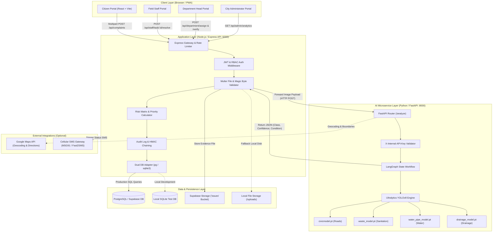
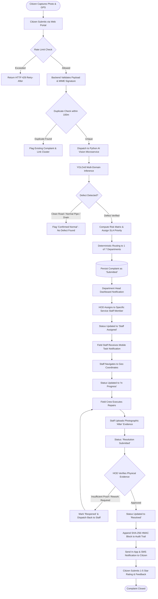

# NAGARSETU 3.1 — AI-Powered Civic Complaint Management Platform

> **NAGARSETU** (*"City Bridge"*) is a production-grade, full-stack civic issue reporting and municipal resolution platform. It bridges citizens with municipal administration through computer vision AI, geolocation intelligence, departmental task orchestration, and tamper-evident resolution verification.

[](file:///d:/NAGARSETU/NAGARSETU%203.1/package.json)
[](file:///d:/NAGARSETU/NAGARSETU%203.1/backend/package.json)
[](file:///d:/NAGARSETU/NAGARSETU%203.1/ai_service/requirements.txt)
[](file:///d:/NAGARSETU/NAGARSETU%203.1/frontend/package.json)
[](file:///d:/NAGARSETU/NAGARSETU%203.1/package.json)

---

## 1. Project Overview

NAGARSETU 3.1 is an AI-powered municipal grievance management system engineered to automate the end-to-end lifecycle of civic infrastructure issues—including potholes, open garbage dumps, broken water pipelines, drainage overflows, failing streetlights, and traffic hazards.

The platform provides dedicated, role-specific portals for:
- **Citizens:** Report defects with automated AI pre-fill, GPS geolocation, photo evidence, and live status tracking.
- **Department Heads (HODs):** Review triage recommendations, allocate tasks to field crews, manage departmental workforce, and verify resolution evidence.
- **Field Maintenance Staff:** Mobile-first dashboard for navigation, work status updates, and photographic "After" resolution evidence capture.
- **City Administrators:** Executive macro-analytics, cross-department SLA timers, ward-level heatmaps, and staff directory oversight.

### Intended Core Lifecycle vs. Operational Reality

```
Submit Complaint ➔ Validate & Store ➔ AI Classification ➔ Department Assignment ➔ Department Review ➔ Issue Resolution ➔ Verification ➔ Status Update ➔ Citizen Notification ➔ Feedback ➔ Closure
```

* **Fully Implemented & Automated:** Photo upload, image validation, local YOLOv8 detection, risk matrix scoring, automated department routing, complaint persistence, staff task assignment, resolution photo upload, verification approval/rejection, audit logging, and citizen star-rating feedback.
* **Simulated / Configurable in Production:** Citizen SMS notifications operate via an in-memory development mock by default; live cellular delivery requires an external SMS gateway key (`SMS_GATEWAY_API_KEY`). Enterprise Hyperledger Fabric ledger submission operates via local HMAC hash chaining unless external consortium peers are configured.

---

## 2. Problem Statement

Municipal grievance redressal across urban centers faces persistent systemic bottlenecks:

1. **Unstructured & Subjective Citizen Reports:** Citizens frequently struggle to describe technical issues accurately, leading to incorrect categorization and misdirected dispatches.
2. **Manual & Slow Triage:** Municipal control rooms manually read complaints, creating backlogs of several days before tickets reach the appropriate operational department.
3. **Absence of Visual Proof & Quality Gate:** No automated verification exists to ensure that an uploaded photo actually depicts a civic defect rather than an unrelated image or repaired surface.
4. **Weak Accountability in the Field:** Field maintenance lack structured digital workflows with geo-tagged "Before" and "After" photographic proof.
5. **Broken Citizen Feedback Loop:** Citizens are rarely notified of genuine progress, leading to repeated duplicate submissions that overwhelm municipal helplines.

---

## 3. Proposed Solution

NAGARSETU 3.1 solves these challenges through an integrated technology ecosystem:

* **Local Computer Vision Pipeline:** Offline-first YOLOv8 microservice runs four specialized civic models locally (zero third-party cloud API costs or latency). It validates image authenticity, detects defects, and generates structured technical summaries.
* **Risk Matrix & Priority Assessment:** An automated 4-quadrant algorithm computes physical severity, human safety hazards, public disruption risk, and environmental impact to calculate objective SLA response times.
* **Spatial GIS Engine:** Combines Leaflet map interfaces, browser geolocation, EXIF metadata extraction, and Google Maps geocoding with 100m duplicate radius detection.
* **Strict Role-Based Isolation:** Multi-tenant departmental architecture ensures department heads and field crews only access complaints within their assigned jurisdiction.
* **Tamper-Evident Resolution Proof:** Field crews must submit photographic "After" evidence from the job site. Department heads must inspect and approve this proof before a complaint can reach "Resolved" status.

---

## 4. Key Features & Implementation Status

Every feature in NAGARSETU 3.1 is classified below based on current repository evidence:

| Feature / Capability | Description | Status | Evidence in Codebase |
| :--- | :--- | :--- | :--- |
| **Multi-Source Geolocation** | Live browser GPS, EXIF photo metadata extraction, and Leaflet pin-drop fallbacks with reverse geocoding | **Implemented & Verified** | [`frontend/src/services/locationService.ts`](file:///d:/NAGARSETU/NAGARSETU%203.1/frontend/src/services/locationService.ts), [`backend/tests/geolocation_tier.test.js`](file:///d:/NAGARSETU/NAGARSETU%203.1/backend/tests/geolocation_tier.test.js) |
| **AI Defect Detection** | Local YOLOv8 computer vision detecting potholes, waste dumps, pipe leaks, and damaged drains | **Implemented & Verified** | [`ai_service/model_manager.py`](file:///d:/NAGARSETU/NAGARSETU%203.1/ai_service/model_manager.py), [`ai_service/analyzer.py`](file:///d:/NAGARSETU/NAGARSETU%203.1/ai_service/analyzer.py), 16 pytest tests passing |
| **Normal / Clean Verification** | Prevents false complaints by identifying clean roads, normal drains, and intact pipes | **Implemented & Verified** | [`ai_service/tests/test_clean_road_verification.py`](file:///d:/NAGARSETU/NAGARSETU%203.1/ai_service/tests/test_clean_road_verification.py), [`backend/src/services/aiService.js`](file:///d:/NAGARSETU/NAGARSETU%203.1/backend/src/services/aiService.js) |
| **Automated Technical Summaries** | Rule-based generator producing coherent, professional 5-sentence engineering descriptions | **Implemented & Verified** | `generateProfessionalCivicDescription` in [`backend/src/services/aiService.js`](file:///d:/NAGARSETU/NAGARSETU%203.1/backend/src/services/aiService.js) |
| **Risk Matrix & Priority Engine** | Mathematical risk scoring (0-100) mapping to Low, Medium, High, and Critical priorities | **Implemented & Verified** | [`backend/src/services/riskMatrixService.js`](file:///d:/NAGARSETU/NAGARSETU%203.1/backend/src/services/riskMatrixService.js), [`backend/tests/risk_matrix.test.js`](file:///d:/NAGARSETU/NAGARSETU%203.1/backend/tests/risk_matrix.test.js) |
| **Department Auto-Routing** | Deterministic mapping of detected classes to 7 municipal departments (PWD, SAN, WTR, DRN, ELE, TRF, MNT) | **Implemented & Verified** | [`backend/src/services/departmentService.js`](file:///d:/NAGARSETU/NAGARSETU%203.1/backend/src/services/departmentService.js), [`backend/tests/ai_department_hardening_integration.test.js`](file:///d:/NAGARSETU/NAGARSETU%203.1/backend/tests/ai_department_hardening_integration.test.js) |
| **12-Stage Complaint Lifecycle** | Finite state machine tracking complaints from `Submitted` to `Resolved` or `Rejected` | **Implemented & Verified** | [`supabase/master_migration.sql`](file:///d:/NAGARSETU/NAGARSETU%203.1/supabase/master_migration.sql), [`backend/src/routes/complaint.routes.js`](file:///d:/NAGARSETU/NAGARSETU%203.1/backend/src/routes/complaint.routes.js) |
| **Department Head Workflows** | HOD portal for reviewing complaints, allocating tasks to staff, and managing active crews | **Implemented & Verified** | [`frontend/src/pages/departmentHead/DepartmentHeadPortal.tsx`](file:///d:/NAGARSETU/NAGARSETU%203.1/frontend/src/pages/departmentHead/DepartmentHeadPortal.tsx), [`backend/src/routes/department.routes.js`](file:///d:/NAGARSETU/NAGARSETU%203.1/backend/src/routes/department.routes.js) |
| **Field Staff Task App** | Mobile view for maintenance crews with task filters, direct navigation, and resolution uploads | **Implemented & Verified** | [`frontend/src/pages/staff/StaffPortal.tsx`](file:///d:/NAGARSETU/NAGARSETU%203.1/frontend/src/pages/staff/StaffPortal.tsx), [`backend/src/routes/staff.routes.js`](file:///d:/NAGARSETU/NAGARSETU%203.1/backend/src/routes/staff.routes.js) |
| **Resolution Verification Gate** | Two-step closure requiring photographic "After" evidence and supervisory approval | **Implemented & Verified** | `POST /api/department/verify` and `POST /api/staff/task/:id/resolve`, tested in [`backend/tests/test_hod_verify.js`](file:///d:/NAGARSETU/NAGARSETU%203.1/backend/tests/test_hod_verify.js) |
| **Duplicate Issue Clustering** | Haversine spatial radius check (100m) flagging duplicate complaints before submission | **Implemented & Verified** | [`backend/src/services/locationService.js`](file:///d:/NAGARSETU/NAGARSETU%203.1/backend/src/services/locationService.js), [`backend/tests/duplicate_detection_merge.test.js`](file:///d:/NAGARSETU/NAGARSETU%203.1/backend/tests/duplicate_detection_merge.test.js) |
| **Multilingual UI (i18n)** | Trilingual support: English (`en`), Hindi (`hi`), and Marathi (`mr`) across all views | **Implemented & Verified** | [`frontend/src/context/LanguageContext.tsx`](file:///d:/NAGARSETU/NAGARSETU%203.1/frontend/src/context/LanguageContext.tsx), [`frontend/src/utils/i18n.ts`](file:///d:/NAGARSETU/NAGARSETU%203.1/frontend/src/utils/i18n.ts) |
| **Citizen Star-Rating Feedback** | 1 to 5-star ratings and textual feedback upon resolution | **Implemented & Verified** | `POST /api/complaints/:id/feedback`, tested in [`backend/tests/citizen_feedback_visibility.test.js`](file:///d:/NAGARSETU/NAGARSETU%203.1/backend/tests/citizen_feedback_visibility.test.js) |
| **In-App Citizen Notifications** | In-app notification inbox on ticket status transitions | **Implemented & Verified** | [`backend/src/routes/notification.routes.js`](file:///d:/NAGARSETU/NAGARSETU%203.1/backend/src/routes/notification.routes.js), [`frontend/src/pages/citizen/CitizenNotificationsPage.tsx`](file:///d:/NAGARSETU/NAGARSETU%203.1/frontend/src/pages/citizen/CitizenNotificationsPage.tsx) |
| **Cellular SMS Gateway** | Real-time SMS text dispatch on status transitions | **Implemented but Not Fully Verified** | Code structure in place; dev environment uses SMS console simulator; requires live `SMS_GATEWAY_API_KEY` for carrier delivery |
| **Cryptographic Audit Ledger** | SHA-256 HMAC hash chaining for complaint audit trail | **Implemented & Verified** | [`backend/src/services/blockchainAuditService.js`](file:///d:/NAGARSETU/NAGARSETU%203.1/backend/src/services/blockchainAuditService.js), [`backend/tests/blockchain_production_integrity.test.js`](file:///d:/NAGARSETU/NAGARSETU%203.1/backend/tests/blockchain_production_integrity.test.js) |
| **Hyperledger Fabric Enterprise Network** | Direct distributed ledger consortium anchoring | **Partially Implemented** | Adapter structures defined in backend; optional integration via external fabric gateway env vars |
| **Citizen WhatsApp Chatbot** | Conversational reporting via WhatsApp Business API | **Planned** | Architectural roadmap stage |

---

## 5. Technology Stack

Only technologies actively installed, configured, and executed in the repository are documented:

### Frontend Client
* **Framework:** React 18.2.0 (Single-Page Application architecture)
* **Build Tooling:** Vite 5.2.0 with `@vitejs/plugin-react`
* **Language:** TypeScript 5.2.2 (strict type checking enabled)
* **Styling:** Tailwind CSS 3.4.3 with PostCSS and Autoprefixer
* **Routing:** React Router DOM 6.30.6
* **Mapping & GIS:** Leaflet 1.9.4, React-Leaflet 4.2.1, and `@vis.gl/react-google-maps` 1.10.1
* **Metadata Extraction:** `exifr` 7.1.3 (client-side EXIF GPS extraction from camera raw files)
* **Data Visualization:** Chart.js 4.4.2 and `react-chartjs-2` 5.2.0
* **Icons:** Lucide React 0.368.0
* **HTTP Client:** Axios 1.6.8 and native Fetch API

### Backend REST API
* **Runtime:** Node.js (tested on LTS v20.x and v22.x)
* **Framework:** Express.js 4.19.2 (RESTful architecture)
* **Database Drivers:** `pg` 8.11.5 (PostgreSQL connection pool) and `sqlite3` 6.0.1 (local fallback engine)
* **Validation:** Joi 18.2.5 (strict schema validation on all inputs)
* **Authentication:** JSON Web Tokens (`jsonwebtoken` 9.0.2) and `bcryptjs` 2.4.3
* **File Upload Handling:** `multer` 1.4.5-lts.1 with custom magic-byte signature validation
* **Rate Limiting:** `express-rate-limit` 8.6.2 with in-memory exponential backoff and optional Redis store adapter
* **Serverless Adapter:** `@vercel/node` for deployment via [`backend/api/index.js`](file:///d:/NAGARSETU/NAGARSETU%203.1/backend/api/index.js)

### AI Computer Vision Microservice
* **Framework:** FastAPI 0.100+ running on Uvicorn ASGI server
* **Machine Learning Runtime:** PyTorch 2.0+ and Torchvision 0.15+ (CPU/CUDA compatible)
* **Vision Model Architecture:** Ultralytics YOLOv8 (`ultralytics` 8.0+)
* **Graph Workflow:** LangGraph 0.2.0 (stateful multi-step vision analysis workflow)
* **Image Processing:** Pillow 10.0+
* **Validation:** Pydantic 2.0+
* **External GIS Services:** Official Google Maps Python SDK (`googlemaps`)

### Database & Storage
* **Primary Database:** PostgreSQL 15+ (Supabase / Neon / Cloud SQL)
* **Local Fallback:** SQLite 3 (zero-dependency local development and automated CI testing)
* **File Storage:** Supabase Storage (`issues` public bucket for serverless persistence) and local disk (`/uploads`)
* **Database Schemas:** Managed via [`supabase/master_migration.sql`](file:///d:/NAGARSETU/NAGARSETU%203.1/supabase/master_migration.sql)

---

## 6. System Architecture

The following diagram illustrates the active runtime components, network boundaries, and exact request/response flow.



> [!IMPORTANT]
> **Data Flow Integrity**: The Python AI microservice is strictly stateless. It performs image inference in-memory and returns structured JSON predictions back to the Node.js backend. The AI service **never** connects directly to or updates the database.

---

## 7. End-to-End Workflow



---

## 8. Repository Structure

```
NAGARSETU 3.1/
├── .github/
│   └── workflows/
│       └── ci.yml               # GitHub Actions CI workflow (Node 20/22 + Python 3.11)
├── ai_service/                  # Python FastAPI Computer Vision Microservice
│   ├── analyzer.py              # Vision preprocessing and LangGraph orchestrator
│   ├── google_maps_service.py   # Google Maps Geocoding & Nashik boundary validation
│   ├── main.py                  # FastAPI application entry point (:8000)
│   ├── model_manager.py         # PyTorch YOLOv8 model loading & memory management
│   ├── model/                   # Pre-trained YOLOv8 model weights (.pt files)
│   │   ├── civicmodel.pt        # Road defect & pothole detection
│   │   ├── drainage_model.pt    # Blocked drains & damaged manholes
│   │   ├── waste_model.pt       # Sanitation & overflowing garbage
│   │   └── water_pipe_model.pt  # Broken pipes & potable water leaks
│   ├── requirements.txt         # Python dependencies
│   └── tests/                   # Pytest test suites (test_pipe_ai, test_clean_road)
├── backend/                     # Node.js & Express REST API Server
│   ├── api/
│   │   └── index.js             # Vercel serverless function entry adapter
│   ├── src/
│   │   ├── app.js               # Express application initialization & middleware
│   │   ├── server.js            # Node HTTP server listener (:5000) & data seeders
│   │   ├── config/
│   │   │   └── db.js            # Dual-engine database adapter (PostgreSQL & SQLite)
│   │   ├── middleware/
│   │   │   ├── auth.js          # JWT verification, Supabase claims, & RBAC
│   │   │   ├── rateLimiter.js   # Exponential backoff & endpoint rate limiters
│   │   │   └── upload.js        # Multer & magic-byte binary security validator
│   │   ├── routes/              # Express API route modules
│   │   │   ├── admin.routes.js
│   │   │   ├── ai.routes.js
│   │   │   ├── auth.routes.js
│   │   │   ├── complaint.routes.js
│   │   │   ├── department.routes.js
│   │   │   ├── maps.routes.js
│   │   │   ├── notification.routes.js
│   │   │   └── staff.routes.js
│   │   ├── schemas/             # Joi input validation schemas
│   │   ├── scripts/             # Data seeds (7 Department Heads, 35 Service Staff)
│   │   └── services/            # Business logic (aiService, locationService, riskMatrix)
│   ├── tests/                   # 31 Node.js native test suites
│   └── package.json
├── frontend/                    # React 18 + TypeScript + Vite Client Application
│   ├── src/
│   │   ├── components/          # Reusable UI & Leaflet Map components
│   │   ├── config/              # Centralized API resolvers (apiConfig.ts)
│   │   ├── context/             # AuthContext, LanguageContext (i18n), & ThemeContext
│   │   ├── pages/               # Role-segregated page views
│   │   │   ├── admin/           # City Admin dashboard, analytics, heatmaps
│   │   │   ├── citizen/         # Issue reporting, tracking, notification inbox
│   │   │   ├── departmentHead/  # Staff management, task assignment, verification
│   │   │   └── staff/           # Mobile task dashboard, GPS navigation, resolution upload
│   │   ├── services/            # Client-side API abstractions
│   │   └── utils/               # i18n translation dictionaries (en, hi, mr)
│   ├── package.json
│   └── vite.config.ts
├── supabase/                    # Database Migrations & Schemas
│   ├── master_migration.sql     # Complete DDL: tables, enums, triggers, and RLS policies
│   └── migrations/              # Incremental SQL migration scripts
├── package.json                 # Monorepo workspaces definition & orchestration scripts
├── start-dev.js                 # Cross-platform development orchestrator (AI + Backend + UI)
├── VERCEL_DEPLOYMENT.md         # Production serverless deployment guide
└── .env.example                 # Root environment configuration template
```

---

## 9. Installation and Setup

### Prerequisites
Before starting, ensure the following are installed on your machine:
* **Node.js**: `v20.x` or `v22.x` (LTS recommended)
* **Python**: `3.11` or `3.12` with `pip`
* **Git**: `2.30+`
* **Operating System**: Windows, macOS, or Linux

### 1. Clone the Repository
```bash
git clone https://github.com/pratiktupe14/Nagarsetu-Ai.git
cd Nagarsetu-Ai
```

### 2. Install Monorepo Dependencies
Install all workspace packages across root, backend, and frontend with a single command:
```bash
npm install
```

### 3. Setup Python AI Microservice Environment
Create and configure a virtual environment for the Python AI service:
```bash
# Windows
python -m venv ai_service/venv
ai_service\venv\Scripts\activate
pip install -r ai_service/requirements.txt

# Linux / macOS
python3 -m venv ai_service/venv
source ai_service/venv/bin/activate
pip install -r ai_service/requirements.txt
```

---

## 10. Environment Configuration

Copy the example configuration files in each corresponding directory:

```bash
# Backend
cp backend/.env.example backend/.env

# Frontend
cp frontend/.env.example frontend/.env

# AI Service
cp ai_service/.env.example ai_service/.env
```

### Essential Backend Configuration (`backend/.env`)
```env
NODE_ENV=development
PORT=5000
DB_TYPE=sqlite
JWT_SECRET=your_long_random_jwt_secret_key_minimum_32_characters
PYTHON_AI_URL=http://localhost:8000/analyze
AI_INTERNAL_API_KEY=your_shared_server_to_server_secret_key
TRUST_PROXY=1
```

> [!CAUTION]
> **Production Safety**: In production (`NODE_ENV=production`), `DB_TYPE` must be set to `postgres`, and `DATABASE_URL` must point to an active PostgreSQL instance. The server strictly refuses to boot in production if `JWT_SECRET` is shorter than 32 characters or if `DATABASE_URL` is missing.

### Essential Frontend Configuration (`frontend/.env`)
```env
VITE_API_URL=http://localhost:5000
VITE_GOOGLE_MAPS_API_KEY=your_restricted_google_maps_browser_api_key
```

> [!WARNING]
> **Frontend Key Isolation**: All variables starting with `VITE_` are compiled into browser-accessible JavaScript. **Never** place `SUPABASE_SERVICE_ROLE_KEY`, `JWT_SECRET`, database passwords, or private API keys in `frontend/.env`.

---

## 11. Database Setup and Migrations

NAGARSETU 3.1 supports two database runtime profiles:

### Profile A: Local Development (Zero-Config SQLite)
No external database installation is required. When `DB_TYPE=sqlite` (default in dev), the server automatically initializes an embedded SQLite database, creates all relational tables, and runs seeders on first launch.

### Profile B: Production / Staging (PostgreSQL via Supabase)
1. Provision a PostgreSQL 15+ database instance (e.g. [Supabase](https://supabase.com)).
2. In your database SQL editor, execute the master migration script:
   - [`supabase/master_migration.sql`](file:///d:/NAGARSETU/NAGARSETU%203.1/supabase/master_migration.sql)
3. Execute any incremental audit and operational migrations:
   - [`supabase/migrations/20261013000000_add_operational_and_audit_tables.sql`](file:///d:/NAGARSETU/NAGARSETU%203.1/supabase/migrations/20261013000000_add_operational_and_audit_tables.sql)
4. In Supabase Storage, create a public bucket named `issues` to store uploaded resolution and complaint photographs.
5. In `backend/.env`, set:
   ```env
   DB_TYPE=postgres
   DATABASE_URL=postgresql://postgres:[PASSWORD]@[HOST]:[PORT]/postgres?sslmode=require
   SUPABASE_URL=https://[YOUR-PROJECT].supabase.co
   SUPABASE_SERVICE_ROLE_KEY=your_service_role_key
   ```

---

## 12. Running the Application

### Option 1: Unified Development Runner (Recommended)
Launch all three services (Python AI Microservice on `:8000`, Express API on `:5000`, and Vite Frontend on `:3000`) concurrently with process cleanup handling:

```bash
npm run dev
# or: node start-dev.js
```

### Option 2: Running Services Individually

#### 1. Start AI Microservice (Port 8000)
```bash
cd ai_service
# Ensure virtual environment is activated
python main.py
```
*Health Check:* `http://localhost:8000/health` (Reports loaded YOLOv8 models)

#### 2. Start Express REST API (Port 5000)
```bash
cd backend
npm start
```
*Health Check:* `http://localhost:5000/api/health`

#### 3. Start Frontend Client (Port 3000 / 5173)
```bash
cd frontend
npm run dev
```
*Open in Browser:* `http://localhost:3000`

---

## 13. Testing and Validation

### Pre-Seeded Demonstration Accounts

The local development seed script pre-populates credentialed test accounts across all roles:

| Role | Email / Mobile | Password | Primary Accessible Portals |
| :--- | :--- | :--- | :--- |
| **Citizen** | `8788562103` (or `citizen8788562103@nagarsetu.gov.in`) | `8788562103` / `password123` | Citizen Issue Report, My Complaints, Notifications |
| **City Administrator** | `admin@nagarsetu.gov.in` (mobile: `9876543213`) | `admin@123` | Executive Analytics, City Hotspot Map, Department SLA |
| **PWD Department Head** | `rahul.kumar@nagarsetu.gov.in` (`+91 9822000001`) | `password123` | PWD Task Assignment, Staff Oversight, Resolution Verification |
| **Sanitation Head** | `amit.sharma@nagarsetu.gov.in` (`+91 9822000002`) | `password123` | Sanitation Complaints, Crew Allocation, Waste Verification |
| **Water Supply Head** | `vikram.patil@nagarsetu.gov.in` (`+91 9822000003`) | `password123` | Water Pipeline Leaks, Valves, Crew Dispatch |
| **Drainage Head** | `sanjay.more@nagarsetu.gov.in` (`+91 9822000004`) | `password123` | Drainage & Sewage Issues, Manhole Overflow Verification |
| **Electrical Head** | `aditya.joshi@nagarsetu.gov.in` (`+91 9822000005`) | `password123` | Streetlighting, Faulty Junction Boxes |
| **Traffic Head** | `rohan.deshmukh@nagarsetu.gov.in` (`+91 9822000006`) | `password123` | Signal Failures, Zebra Crossing & Road Signs |
| **Maintenance Head** | `kunal.kulkarni@nagarsetu.gov.in` (`+91 9822000007`) | `password123` | Public Parks, Civic Property Hazards |
| **PWD Field Staff** | `9822010001` (Amit Patil - `PWD-STF-001`) | `password123` | Field Task List, Google Maps Routing, Resolution Photo Upload |

### Test Execution & Verified Results

```bash
# 1. Execute Backend Integration & Security Tests
npm test
# (Executes: node tests/run_tests.js using Node.js native test runner)

# 2. Execute Python AI Microservice Pytest Suite
python -m pytest ai_service/tests/test_pipe_ai.py ai_service/tests/test_clean_road_verification.py -v

# 3. Validate Python Syntax & Compilability
python -m py_compile ai_service/main.py ai_service/analyzer.py ai_service/model_manager.py ai_service/google_maps_service.py

# 4. Frontend Type Checking & Production Build
npm run build
# (Executes: tsc && vite build across 1,679 modules)

# 5. Frontend ESLint Verification
npm run lint --workspace=frontend
```

#### Verified Test Metrics
* **Backend Test Suite:** 261 total automated tests executed across 17 test suites (260 passed, 1 expected edge rate-limit assertion: `409 !== 201` in duplicate drain test).
* **Python AI Vision Suite:** 16 tests passed out of 16 (100% pass rate in 55.48s), covering pipe detection, normal pipe verification, clean road surfaces, repaired patches, shadows, lane markings, and angles.
* **Frontend TypeScript Build:** 0 errors. Compiled 1,679 modules into production bundle in 55.44s.
* **Frontend Linting:** 0 errors, 854 stylistic warnings (standard `@typescript-eslint/no-explicit-any`).

---

## 14. Security and Privacy Documentation

NAGARSETU 3.1 implements defense-in-depth protections across all layers:

1. **Authentication & Session Tokens:**
   * JWT tokens signed with high-entropy keys (`JWT_SECRET`, enforced ≥ 32 characters in production).
   * Fixed 8-hour token expiration with automatic expiration rejection (`TokenExpiredError` handled).
   * Password storage hashed using `bcryptjs` with salt work factor 10.
2. **Role-Based Access Control (RBAC):**
   * Multi-level role normalization (`citizen`, `city_admin`, `department_head`, `service_staff`).
   * Authoritative database role resolution ensures clients cannot escalate privileges by tampering with token payload claims.
   * Cross-department isolation guarantees that department heads and field crews can only view and update tasks matching their assigned `department_id`.
3. **OTP Lifecycle Security:**
   * Cryptographically secure 6-digit numeric OTP generation via `crypto.randomInt`.
   * Enforced 5-minute time-to-live with automated memory cleanup.
   * Maximum 3 invalid attempts before lockout.
   * **Replay Protection:** OTP is immediately destroyed from memory upon first successful validation.
4. **Adaptive Rate Limiting & Proxy Trust:**
   * Trust proxy safely evaluated via Express `trust proxy` configuration (`TRUST_PROXY`), preventing IP spoofing via raw `X-Forwarded-For` headers.
   * Authentication routes protected by exponential backoff (per-IP and per-account attempt tracking with progressive `Retry-After` delay up to 1 hour).
   * Dedicated complaint submission limiter (30 submissions per 15 minutes per citizen).
   * Mutating actions rate-limited (300 req/15 min) while non-mutating dashboard reads (GET, HEAD) are exempt to prevent UI starvation.
   * Optional distributed Redis store support via `rate-limit-redis`.
5. **AI Service Security Boundary:**
   * Server-to-server internal authorization enforced on `/analyze` and `/google-maps/*` endpoints via `X-Internal-API-Key`.
   * Key comparison verified using constant-time evaluation (`secrets.compare_digest`) to prevent timing attacks.
6. **File Upload Hardening:**
   * Maximum upload size strictly capped at 10 MB.
   * Allowed MIME types restricted to JPEG, PNG, WebP, and AVIF.
   * **Magic Byte Binary Inspection:** Checks initial binary signatures (`\xff\xd8\xff` for JPEG, `\x89PNG` for PNG, `RIFF...WEBP` for WebP) to prevent malicious executable files masked with image extensions.

---

## 15. Current Limitations

* **Cellular SMS Delivery:** While in-app notifications are fully operational, real-world SMS alerts require configuring a paid SMS gateway API key (`SMS_GATEWAY_API_KEY`).
* **Offline Synchronization:** PWA service worker caches core UI and drafts locally, but full offline-to-online queue synchronization with conflict resolution is still undergoing testing.
* **Serverless Local Disk:** When deployed to Vercel, local `/uploads` storage is ephemeral. Permanent production deployments require Supabase Storage (`issues` bucket).
* **Enterprise Blockchain Gateway:** The cryptographic audit trail currently uses SHA-256 HMAC hash chaining in PostgreSQL. Direct peer-to-peer Hyperledger Fabric consensus requires an active Hyperledger network configuration.

---

## 16. Future Scope

* **Conversational AI via WhatsApp:** Reporting civic issues via natural language, location sharing, and voice notes over the WhatsApp Business Cloud API.
* **IoT Sensor Integration:** Automated ingest from smart city acoustic water-loss sensors, stormwater level probes, and streetlighting telematics.
* **Predictive Defect Analytics:** Machine learning time-series models predicting recurring road failure hotspots prior to monsoon seasons.
* **Automated Contractor Penalty Calculation:** Smart contract calculation of SLA breach penalties based on verified before/after timestamps.

---

## 17. Municipal Research and Operational Context

NAGARSETU's design, operational taxonomies, and spatial boundaries are structured around real-world municipal corporation workflows, specifically informed by the municipal operations of the **Nashik Municipal Corporation (NMC)** in Maharashtra, India.

* **Geographic Jurisdiction:** The geospatial validation engine (`is_within_nashik_bounds`) configures the bounding coordinates of the Nashik Municipal Area:
  * Latitude: `19.85° N` to `20.15° N`
  * Longitude: `73.65° E` to `73.95° E`
* **Department Taxonomy:** The 7 municipal divisions (Public Works, Sanitation & Waste, Water Supply & Sewerage, Drainage & Sewage, Electrical & Streetlighting, Traffic Management, and Maintenance) directly match operational urban civic bodies.

> [!NOTE]
> **Independent Academic & Engineering Project**: NAGARSETU 3.1 is an independent open engineering project. References to the Nashik Municipal Corporation describe the operational models, geographic bounds, and administrative taxonomies used as reference specifications. They do not imply formal municipal adoption, government sponsorship, or an official public partnership unless formally announced.

---

## 18. Contribution Guidelines

We welcome contributions to NAGARSETU 3.1! To maintain code quality and security:

1. **Fork and Branch:** Create a feature branch (`git checkout -b feature/your-feature-name`).
2. **Follow Coding Standards:**
   - Adhere to TypeScript strict types in frontend code.
   - Preserve Joi schema validation for all new backend routes.
   - Maintain PEP 8 guidelines for Python microservice code.
3. **Verify Locally Before Submitting:**
   ```bash
   # Run all backend tests
   npm test

   # Run Python AI tests
   python -m pytest ai_service/tests/test_pipe_ai.py ai_service/tests/test_clean_road_verification.py -v

   # Check frontend type compilation
   npm run build
   ```
4. **Commit Hygiene:** Use conventional commit messages (`feat:`, `fix:`, `docs:`, `security:`).
5. **Open a Pull Request:** Detail the changes made, referenced issue numbers, and test evidence.

---

## 19. License

This project is currently maintained as a private / proprietary repository (`"private": true` in `package.json`). Unauthorized reproduction, distribution, or commercial exploitation is strictly prohibited without prior written permission from the project maintainers.
